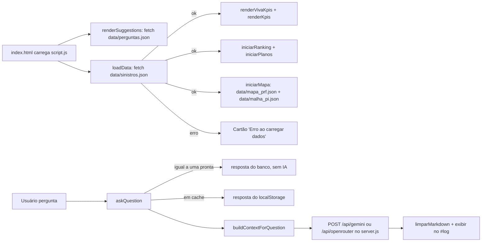
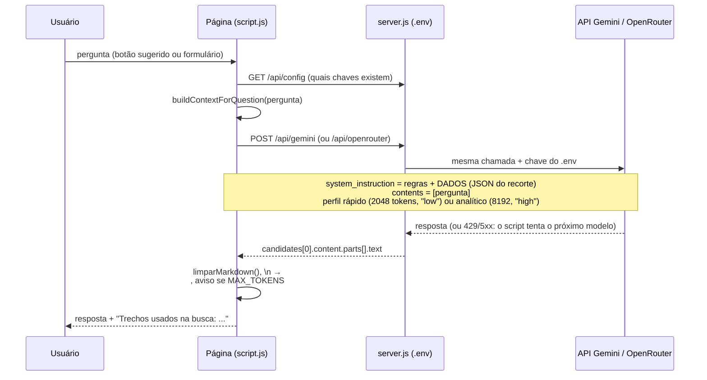

# Observatório de sinistros de trânsito do Piauí (Infotrânsito)

Painel web estático com indicadores de sinistros de trânsito no Piauí (internações, letalidade, locais críticos), mapa das ocorrências nas rodovias federais, ranking exportável de prioridades, planos de ação por território e um assistente de IA que responde perguntas **somente** com base nos dados do projeto, usando a API Gemini do Google.

| | |
|---|---|
| **Projeto** | Infotrânsito: Construção de chatbot com inteligência artificial sobre dados de sinistros de trânsito |
| **Código** | PICCS13381-2025 |
| **Universidade** | Universidade Federal do Piauí (UFPI) |
| **Desenvolvedor** | Victor Hugo de Sousa Monteiro |
| **Orientador** | Márcio Dênis Medeiros Mascarenhas |

---

## Sumário

1. [Visão geral](#1-visão-geral)
2. [Estrutura do projeto](#2-estrutura-do-projeto)
3. [Requisitos](#3-requisitos)
4. [Como executar](#4-como-executar)
5. [Como usar](#5-como-usar)
6. [Como o programa funciona](#6-como-o-programa-funciona)
7. [A base de dados (`data/sinistros.json`)](#7-a-base-de-dados-datasinistrosjson)
8. [Configuração e personalização](#8-configuração-e-personalização)
9. [Segurança e privacidade da chave](#9-segurança-e-privacidade-da-chave)
10. [Limitações conhecidas](#10-limitações-conhecidas)
11. [Solução de problemas](#11-solução-de-problemas)
12. [Fontes dos dados](#12-fontes-dos-dados)

---

## 1. Visão geral

O programa é uma página HTML estática mais um pequeno servidor local (`server.js`, sem dependências) que guarda as chaves de API. Ele faz quatro coisas:

1. **Carrega** `data/sinistros.json`, `data/mapa_prf.json` e `data/malha_pi.json` (via `fetch`) e monta o painel: dois blocos de cartões de indicadores (KPIs), o mapa das rodovias federais, o ranking de prioridades e o plano de ação por território.
2. **Seleciona**, para cada pergunta do usuário, apenas os trechos relevantes do JSON por meio de um índice de palavras-chave embutido na própria base (`indice_busca`), mais os rankings prontos quando a pergunta é de priorização.
3. **Envia** a pergunta e esse recorte dos dados ao `server.js`, que repassa a chamada ao Gemini (`MODEL` em `script.js`) e, se ele falhar, a modelos gratuitos do OpenRouter. As chaves ficam no arquivo `.env` e nunca chegam ao navegador. A resposta aparece no chat, sempre terminando com a fonte e o período dos dados.
4. **Exporta** o ranking em CSV e o ranking ou o plano em PDF (pela impressão do navegador).

Mapa, ranking e planos não usam bibliotecas externas: o mapa é desenhado em `<canvas>` e tudo funciona sem internet (só o chat precisa dela).

O servidor (`node server.js`) serve os arquivos do painel e expõe só `/api/config`, `/api/gemini` e `/api/openrouter`. As únicas chamadas externas são para `generativelanguage.googleapis.com` e `openrouter.ai`, e só acontecem quando o usuário faz uma pergunta.

## 2. Estrutura do projeto

```
sinistros_de_transito-master/
├── server.js              # Servidor local: serve o painel e repassa as chamadas de IA com as chaves do .env
├── package.json           # Só o comando "npm start" e a versão mínima do Node; sem dependências
├── .env                   # Suas chaves (GEMINI_API_KEY, OPENROUTER_API_KEY); fora do Git
├── .gitignore             # Ignora .env, node_modules/ e DADOS SINISTROS/
├── index.html             # Estrutura da página (≈820 KB: inclui 3 cópias do brasão da UFPI em base64)
├── script.js              # Toda a lógica: carga dos dados, painel, mapa interativo, ranking, planos, sugestões no chat, busca e chat (≈1.880 linhas)
├── style.css              # CSS compilado do Tailwind v4 + tema do projeto; no fim, CSS à mão do mapa, ranking e planos
├── data/
│   ├── sinistros.json     # Base consolidada + planos por território + cores do mapa + índice de busca (≈1 MB; ≈100 KB com gzip)
│   ├── perguntas.json     # 388 perguntas e respostas prontas (geradas por scripts/gerar_perguntas.py)
│   ├── saude_municipios.json # Óbitos (SIM) e internações (SIH) por município de residência, 2020–2024, e população 2022 (TABNET/IBGE)
│   ├── vias_pi.json       # Traçado das rodovias federais e estaduais do Piauí (OpenStreetMap), simplificado (≈330 KB)
│   ├── mapa_prf.json      # Ocorrências da PRF com coordenadas, para o mapa e os rankings (≈330 KB)
│   ├── malha_pi.json      # Malha municipal do Piauí (IBGE), simplificada, para o mapa (≈145 KB)
│   └── prf_acidentes_pi.csv  # Ocorrências da PRF filtradas para o Piauí (8.719 linhas), usado pelos scripts
└── scripts/               # Python 3 sem bibliotecas: importar_prf, interpretar_prf, gerar_planos, importar_saude_vias, gerar_territorios, gerar_perguntas
```

Não há `.env.example` no projeto: crie o `.env` à mão (veja [Como executar](#4-como-executar)).

- `index.html` contém apenas a estrutura: cabeçalho, as seções do painel (`#vivaGrid`, `#kpiGrid`, mapa `#mapaSec`, ranking `#locaisTable`, plano `#planoSec`), o chat (`#suggestions`, `#log`, `#askForm`) e o rodapé. Foi exportado de um gerador de páginas (meta `author: Lovable`), por isso as classes utilitárias e os marcadores `<!--$-->`.
- `script.js` é carregado com `defer` e roda ao final do HTML. Não há dependências JavaScript externas.
- `style.css` é a saída compilada do Tailwind v4; não é necessário instalar o Tailwind para rodar o projeto.

## 3. Requisitos

| Item | Para quê | Observação |
|---|---|---|
| Navegador moderno (Chrome/Edge/Firefox/Safari atuais) | Rodar a página | Usa `fetch`, `async/await`, template strings e CSS `oklch()`/`color-mix()` |
| Node.js 18 ou superior | Rodar `server.js` | **Obrigatório** — abrir `index.html` direto do disco (`file://`) faz o `fetch` do JSON falhar. Testado com Node v24.22.1 no Windows 10 |
| Python 3 | Só para atualizar os dados (`scripts/`) | Sem bibliotecas extras; testado com Python 3.12 |
| Chave Gemini e/ou OpenRouter | Só para o chat | Gemini: `aistudio.google.com`. OpenRouter: `openrouter.ai/keys`. Vão no `.env`. O painel funciona sem elas |
| Acesso à internet | Só para o chat | O painel funciona offline, pois o JSON é local |

Nada precisa ser instalado dentro do projeto: o `package.json` só declara o comando `npm start` (= `node server.js`) e a versão do Node; não há dependências, então `npm install` não é necessário.

### Verificar a instalação do Node

```bash
node --version    # deve mostrar v18 ou superior
```

No Windows, se aparecer **"O termo 'node' não é reconhecido"** logo depois de instalar o Node, o instalador já colocou `C:\Program Files\nodejs` no PATH do sistema, mas os terminais abertos antes da instalação (inclusive o do VS Code) não enxergam a mudança. Feche e abra de novo o VS Code ou o terminal. Até lá, dá para rodar com o caminho completo:

```powershell
& "C:\Program Files\nodejs\node.exe" server.js
```

Se nem `C:\Program Files\nodejs\node.exe` existir, instale o Node (versão LTS) em https://nodejs.org ou com `winget install OpenJS.NodeJS.LTS`.

## 4. Como executar

### Passo a passo

1. Crie um arquivo `.env` na pasta do projeto e preencha `GEMINI_API_KEY` e/ou `OPENROUTER_API_KEY` (pelo menos uma é necessária para o chat):

```ini
GEMINI_API_KEY=sua_chave_gemini
OPENROUTER_API_KEY=sk-or-sua_chave_openrouter
# Opcionais:
# PORT=8000
# HOST=127.0.0.1
# LIMITE_IP_POR_HORA=40
# LIMITE_TOTAL_POR_DIA=800
```

2. Na pasta do projeto, rode:

```bash
node server.js
```

3. Abra **http://localhost:8000** (a porta muda com `PORT` no `.env`). O terminal mostra quais chaves foram carregadas. Depois de editar o `.env`, reinicie o servidor.

O servidor só aceita conexões da própria máquina (`HOST=127.0.0.1`). Mude `HOST` apenas se quiser expô-lo na rede, sabendo que qualquer pessoa conectada passará a gastar suas chaves.

### Publicação no Render (plano gratuito)

1. No Render: **New → Web Service**, conecte o repositório do GitHub e escolha o branch `master`.
2. **Language:** Node. **Build Command:** `npm install`. **Start Command:** `npm start`. **Instance Type:** Free.
3. Em **Environment Variables**, crie `GEMINI_API_KEY` e/ou `OPENROUTER_API_KEY`. Não defina `PORT` nem `HOST`: o Render fornece a porta e o servidor ouve em `0.0.0.0` sozinho.
4. Em **Advanced → Health Check Path**, use `/healthz`.
5. **Create Web Service.** O endereço fica no formato `https://NOME.onrender.com`.

No plano gratuito o serviço **dorme após 15 minutos sem acesso** e a primeira visita seguinte demora cerca de 1 minuto; há 750 horas de instância por mês. Quando o serviço reinicia, os contadores de limite de uso (em memória) voltam a zero.

### Publicação no Railway

O Railway executa o `server.js` como está. Passo a passo (confira os nomes dos menus, que podem mudar):

1. Coloque o projeto em um repositório do GitHub (de preferência **privado**). O `.env` e a pasta `DADOS SINISTROS/` já estão no `.gitignore`, então não sobem. O `data/prf_acidentes_pi.csv` precisa subir (os scripts usam).
2. No Railway: **New Project → Deploy from GitHub repo** e escolha o repositório. Ele detecta o Node pelo `package.json` e inicia com `npm start`.
3. Em **Variables**, crie `GEMINI_API_KEY` e/ou `OPENROUTER_API_KEY` com as suas chaves. **Não** defina `PORT` nem `HOST`: o Railway fornece a porta e o servidor passa a ouvir em `0.0.0.0` sozinho (detecta `RAILWAY_ENVIRONMENT`).
4. Em **Settings → Networking → Generate Domain** para obter o endereço público (HTTPS incluso).
5. Opcional: em **Settings → Healthcheck Path** use `/healthz`.

Depois de cada `git push`, o Railway publica de novo. Para mudar as chaves, edite as variáveis (o serviço reinicia).

**Proteções embutidas (ativas fora de 127.0.0.1):**
- limite de **40 chamadas de IA por hora por IP** e **800 por dia no total** (`LIMITE_IP_POR_HORA` e `LIMITE_TOTAL_POR_DIA` nas variáveis); ao estourar, o chat avisa e sugere as perguntas prontas, que continuam funcionando;
- o servidor só aceita modelos do OpenRouter com sufixo `:free` e limita a resposta a 2048 tokens, para ninguém usar suas chaves com modelos pagos;
- o `.env`, o `server.js` e a pasta `.git` nunca são servidos, e o navegador nunca recebe as chaves;
- o IP do visitante é lido de `X-Forwarded-For` (último valor, o que o proxy anexa). Se você usar outro proxy na frente, confira se isso continua válido.

O limite diário protege as cotas gratuitas, mas não é autenticação: qualquer pessoa com o link pode consumir esse limite. Se isso for um problema, acrescente uma senha de acesso ao chat.

Hospedagens **só estáticas** (GitHub Pages, Netlify estático) servem para o painel (mapa, ranking, planos e sugestões no chat incluídos) e para as 388 perguntas prontas, mas não para o chat com IA, que depende do `server.js`.

Para uso em rede local sem nuvem: `HOST=0.0.0.0` no `.env` (e libere a porta no firewall). Os mesmos limites passam a valer.

### Verificação rápida

Ao abrir a página servida por `node server.js` você deve ver, mesmo sem chaves no `.env`:

- 6 cartões em *Perfil dos motociclistas acidentados* (ex.: `20.9%` sem capacete, amostra `9.673`);
- 6 cartões em *Morbidade hospitalar no Piauí* (ex.: `80.251` internações, taxa `176.1`/100 mil hab.);
- o *Mapa interativo* com as regiões de saúde coloridas (5 em vermelho: Tabuleiros do Alto Parnaíba, Vale do Rio Guaribas, Chapada Vale do Rio Itaim, Serra da Capivara e Carnaubais), as rodovias federais (amarelas) e estaduais (claras) e 10 trechos da PRF numerados;
- no chat, a mensagem *Áreas que pedem mais atenção* com um botão por região em vermelho;
- 12 linhas no *Ranking de prioridades* (regiões de saúde), ordenadas da maior para a menor taxa (Carnaubais `272,6` em 1º, Chapada Vale do Rio Itaim `54,2` em 12º);
- o *Plano de ação por território* aberto em Carnaubais, com o selo **prioridade alta**;
- 7 perguntas rápidas no chat, mais o botão **↻ Outras perguntas**.

No terminal, o servidor mostra `Servidor em http://localhost:8000` e se cada chave foi carregada. `http://localhost:8000/healthz` deve responder `ok`, e `http://localhost:8000/api/config` mostra `{"gemini":true,"openrouter":true,...}` quando as duas chaves estão no `.env`.

Se aparecer o cartão vermelho **"Erro ao carregar dados"**, a página foi aberta via `file://` ou o servidor não está rodando — use `node server.js`.

## 5. Como usar

1. Configure as chaves no `.env` (veja [Como executar](#4-como-executar)); o chat não tem campo de chave.
2. Clique em uma das perguntas sugeridas ou digite a sua e pressione **Perguntar**.
3. O assistente mostra "Buscando os dados relevantes e analisando...", depois substitui pela resposta. Abaixo de cada resposta aparece uma linha de diagnóstico: **"Trechos usados na busca: …"** (as palavras-chave reconhecidas) ou **"Nenhuma palavra-chave reconhecida — base completa enviada"**.
4. Cada pergunta é independente: o programa **não envia o histórico** da conversa ao modelo, só a pergunta atual e o recorte de dados.
5. Toda resposta termina com uma linha **"Fonte: …"** com a fonte e o período dos dados usados. Nas respostas prontas, a fonte aparece no rodapé.

### Mapa interativo

- **Cores** (seletor *Colorir por*): nível de atenção, taxa de óbitos, número de óbitos ou taxa de internações, por **região de saúde** ou por **município** (seletor *Áreas*). Os dados são óbitos (SIM) e internações (SIH/SUS) de residentes por acidentes de transporte terrestre, 2020–2024, em todas as vias.
- **Nível de atenção:** vermelho = atenção máxima, laranja = atenção alta, amarelo = abaixo da média do estado. A regra está em [Cores do mapa](#cores-do-mapa-nível-de-atenção).
- **Camadas:** rodovias federais (amarelas, grossas) e estaduais (claras, finas; tracejadas quando o OpenStreetMap indica que não são pavimentadas), trechos críticos da PRF (números) e ocorrências da PRF (pontos; desligadas no início).
- **Navegação:** roda do mouse, botões **+ / −** ou dois dedos aproximam; com zoom, arrastar move o mapa; **⤢** volta ao estado inteiro. A partir de 1,6× aparecem os nomes das BRs e, aproximando mais, os das rodovias estaduais e dos municípios (os em vermelho primeiro). No celular, sem zoom, arrastar rola a página.
- **Passe o mouse** para ver os números da área (óbitos, internações, taxas, % de mortes na via pública na região) ou da rodovia (tipo, superfície, quantos municípios em vermelho ela corta).
- **Clique numa área** (ou num botão de *Áreas em vermelho*) para receber **no chat um plano sugerido**: motivo da cor com números, onde agir primeiro (municípios e rodovias federais e estaduais que os cortam) e as quatro frentes de medidas: gestão de velocidade, infraestrutura viária, fiscalização eletrônica, educação e conscientização. A mensagem tem os botões **Ver plano completo** e **Pedir à IA um plano detalhado**. Com o mapa aproximado, **clicar numa rodovia** traz o plano dela (travessias urbanas, radares, órgão responsável: DNIT/PRF ou DER-PI).
- O bloco *Rodovias federais (PRF)* guarda os filtros de ano, BR e ocorrências e a lista dos 10 trechos críticos.
- Ao abrir a página, o chat mostra as regiões em vermelho com um botão para cada uma.

### Ranking de prioridades

- Cinco tipos: **regiões de saúde** (estudo SIH/SUS 2010–2023: taxa, crescimento pelo VPA, letalidade); **regiões** e **municípios — óbitos e internações** (SIM e SIH 2020–2024, os mesmos números das cores do mapa: nível de atenção, taxa de óbitos, óbitos, taxa de internações); **municípios** e **trechos de 5 km** das BRs (PRF: mortos, ocorrências, gravidade = mortos por 100 ocorrências, crescimento das ocorrências de 2020–2022 para 2023–2025).
- Gravidade e crescimento só valem para municípios com 30 ou mais ocorrências e trechos com 20 ou mais; nas taxas do SIM/SIH, municípios precisam de 10 óbitos ou 30 internações. Assim lugares com poucos casos não aparecem no topo.
- Mostra 20 linhas (**Mostrar todos** abre o resto). **CSV** baixa a lista inteira (separador `;` e vírgula decimal, abre direto no Excel em português); **PDF** abre uma versão para imprimir ou salvar em PDF.
- Clicar numa linha abre o plano do território (no trecho, o do município).

### Plano de ação por território

- Escolha o **tipo** (região de saúde, rodovia federal ou município) e o **território**, agrupados por nível de prioridade.
- Cada plano traz: prioridade e motivos, a cor do mapa e onde agir primeiro, diagnóstico com números, fatores comparados com a média do estado (só PRF), trechos prioritários, ações por eixo (com origem e "por quê"), as **medidas para áreas em vermelho e laranja** (as quatro frentes, com quem executa), metas, indicadores e quem envolver.
- **Discutir no chat** escreve no chat uma pergunta sobre o plano (você pode editar antes de enviar). **PDF** abre o plano para imprimir.
- Há planos para as 12 regiões de saúde, as 7 BRs com 100 ou mais acidentes e 104 municípios: os 44 com 30 ou mais acidentes nas BRs (PRF) e os outros 60 que estão em vermelho no mapa (plano a partir do SIM e do SIH).

### Perguntas rápidas (respostas prontas)

No chat aparecem **7 perguntas rápidas**, uma de cada seção (rodovias federais/PRF, internações no Piauí, TABNET, VIVA 2014, Brasil/UFPI, visão geral e planos de ação), sorteadas a cada vez que a página é aberta ou atualizada; o botão **↻ Outras perguntas** sorteia de novo. As do último sorteio não se repetem no seguinte.

- Elas vêm de `data/perguntas.json` (388 perguntas e respostas em 8 seções) e **são respondidas na hora, sem chamar a IA** (não gastam cota nem precisam de chave). O rodapé mostra a fonte e o período.
- A seção "Planos de ação" inclui as perguntas de priorização ("Quais 10 municípios priorizar nas rodovias federais do Piauí?", "Quais regiões de saúde priorizar…?", trechos e rodovias), as do mapa ("Quais regiões do Piauí estão em vermelho no mapa?", "Que plano de ação seguir nas regiões em vermelho do mapa?", municípios em vermelho e rodovias estaduais que os cortam) e uma pergunta "Qual o plano de ação para …?" por território (123, que aparecem menos nas sugestões).
- Se você digitar uma pergunta igual a uma pronta (sem diferença de acento ou pontuação), ela também é respondida direto do banco; qualquer outra pergunta vai para a IA.
- Perguntas de método, glossário e fontes ("O que é VPA?", "Qual a diferença entre PRF e SUS?"; 14 no total, incluindo toda a seção "Contexto, método e fontes") têm `chip: false`: nunca aparecem como sugestão, mas são respondidas se digitadas.
- Perguntas gerais (`destaque: true`) saem em cerca de 75% dos sorteios; as de detalhe (por BR, ano, faixa etária, região) variam o resto.
- Todas as respostas são **geradas por código** a partir de `data/sinistros.json` e do CSV da PRF, então os números não são digitados à mão. Para atualizá-las depois de mudar os dados:

```bash
python scripts/gerar_perguntas.py
```

Para criar novas perguntas, acrescente chamadas `q(SECAO, pergunta, resposta, fonte)` em `scripts/gerar_perguntas.py` (o script recusa perguntas repetidas). Se `data/perguntas.json` não existir, o chat volta às 5 perguntas fixas de `SUGGESTED_QUESTIONS` em `script.js`, respondidas pela IA.

## 6. Como o programa funciona

### 6.1 Fluxo geral



Ao final de `script.js` são chamadas `renderSuggestions()` (monta os botões de perguntas) e `loadData()`. `data/mapa_prf.json` e `data/malha_pi.json` começam a ser baixados logo no início (`prfPromise`, `malhaPromise`), em paralelo. O estado fica em `dataset` (o JSON da base), `rk` (ranking), `planoAtual` (plano aberto) e `mapa` (dados, filtros e geometria do mapa).

### 6.2 Painel de indicadores

Os cartões são gerados por `kpiCard()` a partir de uma lista `{label, value, unit, danger}`. `danger: true` usa a cor vermelha (`kpi-danger`), caso contrário âmbar (`kpi-amber`). Percentuais passam por `pctFmt()`, que converte a fração do JSON em porcentagem com uma casa decimal (`0.209` → `20.9%`; `null` → `—`).

**Bloco "Perfil dos motociclistas acidentados" — `renderVivaKpis()` (dados nacionais, VIVA 2014):**

| Cartão | Campo do JSON |
|---|---|
| Motociclistas sem capacete (atendidos) | `evento.uso_capacete.nao.total_pct` |
| Envolveram consumo de álcool | `evento.consumo_alcool.sim.total_pct` |
| Evoluíram para internação hospitalar | `atendimento_evolucao.evolucao.internacao_hospitalar.total_pct` |
| Evoluíram para óbito (na amostra) | `atendimento_evolucao.evolucao.obito_outros.total_pct` |
| Faixa etária mais atingida | faixa com maior `total_n` em `perfil_demografico.faixa_etaria` (`faixaMaisAtingida()`) |
| Tamanho da amostra | `fonte_dados_viva_2014.amostra_total` |

**Bloco "Morbidade hospitalar no Piauí (2010–2023)" — `renderKpis()` (dados do Piauí, SIH/SUS):**

| Cartão | Campo do JSON (prefixo `estudo_morbidade_piaui_2010_2023.`) |
|---|---|
| Internações por acidente (2010–2023) | `total_internacoes_periodo` |
| Taxa média de internação | `taxa_internacao_hospitalar_100mil_hab.geral.valor` |
| Óbitos hospitalares no período | `letalidade_hospitalar_pct.obitos_hospitalares_totais_periodo` |
| Letalidade hospitalar | `letalidade_hospitalar_pct.geral.valor` |
| Permanência média internado | `permanencia_media_dias.geral.valor` |
| Ano com mais internações | `ano_com_mais_internacoes.ano` e `.internacoes` |

### 6.3 Ranking de prioridades — `RANKINGS`, `renderRanking()`

1. Cada tipo de `RANKINGS` (`regioes`, `municipios`, `trechos`) define as colunas, os critérios de ordem, a nota de fonte e o plano ligado à linha.
2. **Regiões de saúde:** lê `estudo_morbidade_piaui_2010_2023` (taxa e letalidade por região). `NOMES_REGIAO` e `MACRORREGIAO_DA_REGIAO` dão os nomes; `tendenciaInfo()` traduz a tendência em **alta** (vermelho), **queda** (verde) ou **estável** (cinza).
3. **Municípios e trechos:** `agregarPrf()` soma os pontos de `data/mapa_prf.json` por município ou por trecho (BR + janela de 5 km, município mais frequente). Ordens e desempates são os mesmos de `scripts/gerar_territorios.py`, então os 10 primeiros batem com `planos_por_territorio.priorizacao`, que o chat usa.
4. A coluna do critério escolhido fica destacada; o nível de prioridade vem do plano do território.
5. `exportarRankingCsv()` gera o CSV no navegador (BOM UTF-8, `;`, vírgula decimal). `imprimir()` abre uma janela com versão clara da tabela ou do plano e chama a impressão; o navegador oferece "Salvar como PDF". Se pop-ups estiverem bloqueados, a página avisa.

### 6.4 Mapa — `iniciarMapa()`

1. Carrega `data/malha_pi.json`, `data/vias_pi.json` e `data/mapa_prf.json`; as cores vêm de `atencao_territorial` (em `sinistros.json`).
2. `projetarMapa()` usa projeção equiretangular (longitude corrigida pelo cosseno da latitude média), altura máxima de 720 px, e monta uma vez os `Path2D` dos municípios e das rodovias em "coordenadas base". Zoom e arrasto (`mapa.vista`) só mudam a transformação; `desenharMapa()` agrupa os pedidos num quadro de animação.
3. `colorirAreas()` calcula a cor de cada município (da região ou do próprio município, conforme *Áreas*); `renderLegenda()` mostra as faixas. Nas taxas, as faixas são relativas ao estado (0,8×, 1×, 1,2×, 1,5×); no número de óbitos, são quintis.
4. Rótulos (nomes de rodovias e municípios, números dos trechos) são desenhados na tela, sem zoom, e só entram se não encostarem nos já desenhados; trechos fora da vista somem.
5. `alvoNoPonto()` decide o que está sob o mouse: número de trecho, depois rodovia (só com zoom de 1,6× ou mais, a até 3,5–5 px), depois área (`isPointInPath`). `ligarGestos()` trata roda, arrasto e pinça com Pointer Events.
6. `sugerirNoChat()` e `sugerirViaNoChat()` montam a sugestão de plano no chat a partir dos dados, sem chamar a IA; `apresentarAreasCriticas()` faz a mensagem inicial.
7. Cores vêm das variáveis CSS (`--atencao-*`, `--mapa-1` a `--mapa-5`, `--via-*`); se o canvas não aceitar `oklch()`, usa equivalentes em hex. Um `ResizeObserver` reprojeta quando a largura muda.

### 6.5 Plano de ação por território — `iniciarPlanos()`, `htmlDoPlano()`

Lê `planos_por_territorio` e monta o cartão do plano. `abrirPlano(tipo, chave)` é chamado pelo ranking, pelo mapa e pelos botões do chat. O mesmo HTML vai para a impressão (PDF). Ações são ordenadas por eixo: fiscalização, engenharia, educação, atendimento, articulação, dados; as medidas para áreas em vermelho e laranja vêm em bloco próprio.

### 6.6 Chat: seleção de contexto ("RAG" por palavras-chave)

O coração do assistente é `buildContextForQuestion(question)`. Em vez de mandar os ≈136 mil caracteres do JSON em toda pergunta, ele monta um recorte:

1. **Normaliza** a pergunta com `normalize()`: minúsculas, decomposição Unicode (NFD) e remoção de acentos. Assim "Óbitos" vira `obitos` e casa com a chave `obito`.
2. **Pedido de priorização?** Se a pergunta casar com `INTENCAO_DECISAO` (priorizar, prioridade, ranking, onde investir, por onde começar, "quais 10…"), `caminhosDeDecisao()` acrescenta `criterios_de_prioridade`, `lista_recomendada` e os rankings de `priorizacao` do tipo citado (regiões, municípios, trechos ou rodovias; sem tipo, todos). Se a pergunta citar um território com plano e pedir plano ou ações, vale o plano, não o ranking.
3. **Pedido de plano de ação?** Se a pergunta casar com `INTENCAO_PLANO` (plano, medidas, reduzir, combater, evitar…), `caminhosDePlano()` acrescenta os temas de `planos_de_acao` citados (`TEMAS_PLANO`) e as recomendações dos estudos. Sem território citado, entram também quatro temas gerais (se nenhum tema casar) e o plano integrado; com território, o plano dele (vindo do índice) substitui esses gerais.
4. **Percorre** `dataset.indice_busca`, um dicionário `palavra → [caminhos no JSON]`. Cada palavra é testada com `casaPalavra()`: precisa começar numa fronteira de palavra (`capacete` casa "capacetes", `cid` não casa "acidentes"); termos de até 3 letras exigem a palavra inteira, com plural opcional. Os caminhos das palavras que casarem vão para um `Set` (sem duplicatas). Em pedidos de plano ou de priorização, só entram os caminhos de `interpretacao_prf_piaui` e `planos_por_territorio`, para não inflar o contexto com tabelas brutas. Nomes de regiões de saúde, de municípios com plano e de BRs (`br-316`, `br 316`, `br316`) estão no índice e trazem o plano do território. Quando entra um plano, vêm junto `origens`, `fatores_media_estado_pct` e `limites`. Caminhos cujo "pai" já está no contexto são descartados.
5. **Resolve** cada caminho com `resolvePath()` (`"evento.uso_capacete"` → `dataset.evento.uso_capacete`) e coloca o objeto no contexto, usando o caminho como chave.
6. **Sempre inclui** um `resumo_geral` leve: a ficha da fonte VIVA 2014 e um panorama do Piauí (citação, período, total de internações, taxa média e letalidade).
7. **Fallback:** se nada casar, envia uma visão geral (resumo geral, fonte, total por ano e por BR da PRF e os destaques do Piauí da apresentação da UFPI). A base inteira ficou grande demais para ir em toda pergunta.

Exemplos reais do que é selecionado (obtidos executando o código de `script.js` com a base atual):

| Pergunta | Palavras reconhecidas | Tamanho do contexto |
|---|---|---|
| Onde acontecem mais acidentes no Piauí? | `onde` | ≈12,7 mil caracteres |
| Qual a importância de usar capacete nas motos? | `capacete`, `moto` | ≈4,6 mil |
| Como evoluiu o número de óbitos nos últimos anos? | `obito`, `ano` | ≈12,8 mil |
| Quantas internações houve em Teresina? | `teresina` (inclui o plano de Teresina) | ≈15 mil |
| Qual BR tem mais mortes? | `morte`, `br` | ≈31 mil |
| Como reduzir os acidentes à noite? | plano de ação, `noite` | ≈7,8 mil |
| Quais 10 municípios priorizar? | priorização, `municipio` | ≈8,9 mil |
| Qual o plano para a BR-135? | plano de ação, `br`, `br-135` | ≈20,8 mil |
| Bom dia, tudo bem? | nenhuma → visão geral | ≈6,9 mil |

### 6.7 Chat: chamada à API Gemini — `askQuestion()`



Passo a passo:

1. **Atalhos e validações:** pergunta igual a uma pronta → resposta do banco; pergunta já respondida antes → resposta do cache (`localStorage`). Sem nenhuma chave configurada (ou sem servidor) → mensagem de erro no chat; cotas diárias esgotadas → aviso com o tempo restante; `dataset` ainda nulo → erro pedindo para verificar o JSON. O botão **Perguntar** fica desabilitado durante a chamada.
2. **System prompt** (string montada em `askQuestion`): define o papel ("assistente de análise de segurança viária do Piauí"), obriga a responder **somente** com os dados enviados, impõe estilo curto (3–4 frases, sem markdown, listas com "- "), exige o formato *frase direta → até 3 números de apoio → aviso quando o dado for nacional (VIVA 2014)* e uma última linha **"Fonte: …" com fonte e período**. Tem regras próprias para planos de ação (com o plano do território quando ele existe: prioridade e metas) e para **perguntas de priorização** (critério, lista ordenada com o número que justifica cada posição, quem se destaca em outro ranking e o aviso de que municípios são só rodovias federais). Explica as fontes e manda dizer em uma frase quando a pergunta não puder ser respondida. Ao final, concatena `"DADOS:\n" + JSON.stringify(contexto)`.
3. **Requisição:** o navegador faz `POST /api/gemini?model=…` (ou `/api/openrouter`) ao `server.js`, que acrescenta a chave e repassa ao provedor (`https://generativelanguage.googleapis.com/v1beta/models/${MODEL}:generateContent`). Corpo do Gemini:
   ```json
   {
     "system_instruction": { "parts": [{ "text": "<system prompt + dados>" }] },
     "contents": [{ "role": "user", "parts": [{ "text": "<pergunta>" }] }],
     "generationConfig": { "maxOutputTokens": 2048, "thinkingConfig": { "thinkingLevel": "low" } }
   }
   ```
   (No perfil analítico, `maxOutputTokens` é 8192 e `thinkingLevel` é `"high"`; veja `PERFIS_IA` em [Configuração](#8-configuração-e-personalização).)
4. **Tratamento da resposta:**
   - HTTP não-OK → exibe `error.message` devolvido pela API (ex.: chave inválida) em vermelho;
   - sem `candidates`/texto → exibe o `finishReason` (ex.: bloqueio de segurança);
   - `finishReason === "MAX_TOKENS"` → acrescenta o aviso "(resposta cortada por limite de tokens…)";
   - texto OK → `limparMarkdown()` remove `**negrito**`, `*itálico*`, `#` de títulos e troca marcadores `*`/`•` por `- `; quebras de linha viram `<br>`.
5. **Exibição:** `appendMessage()` cria o balão (classe diferente para `user`/`ai`, variantes `error` e `loading`), remove o texto "Escolha uma pergunta sugerida…" na primeira mensagem e rola o log para o fim.

## 7. A base de dados (`data/sinistros.json`)

Um único JSON com quinze seções de primeiro nível:

| Seção | Conteúdo | Natureza |
|---|---|---|
| `metadata` | título, data de atualização (`ultima_atualizacao`, hoje 2026-10-23), fontes recomendadas e observações | — |
| `fonte_dados_viva_2014` | ficha da pesquisa VIVA 2014 (Ministério da Saúde; 9.673 atendimentos a motociclistas em 86 serviços de urgência de capitais + DF) | **Real, nacional** |
| `perfil_demografico` | sexo, faixa etária, raça/cor, escolaridade, atividade remunerada, plano de saúde (VIVA 2014) | **Real, nacional** |
| `evento` | tipo de vítima, outra parte envolvida, natureza da lesão, parte do corpo, uso de capacete, álcool, relação com trabalho (VIVA 2014) | **Real, nacional** |
| `atendimento_evolucao` | locomoção até o hospital, atendimento prévio, evolução (alta, internação, ambulatório, óbito) (VIVA 2014) | **Real, nacional** |
| `estudo_morbidade_piaui_2010_2023` | artigo Bastos et al., Rev Bras Epidemiol 2026 (SIH/SUS 2010–2023): contexto do estado, 80.251 internações, taxa/letalidade/custo/permanência (geral, por sexo, faixa etária, tipo de vítima, região e macrorregião de saúde, com VPA, IC95% e tendência), análise espacial, achados, limitações e recomendações | **Real, Piauí** |
| `dados_tabnet_piaui_teresina` | consulta bruta TABNET/DATASUS (SIH/SUS, CID-10 V01–V89): Piauí 2009–2026 (2026 parcial) por ano e categoria, e recorte de Teresina; sexo, idade, óbitos, letalidade, permanência e valor médio de AIH | **Real, Piauí** (metodologia diferente do artigo — totais não coincidem) |
| `dados_prf_piaui` | Ocorrências da PRF no Piauí (UF = PI), 2020 a 31/08/2026 (2026 parcial; 8.719 ocorrências, 1.028 mortos): totais por ano, por BR, municípios, trechos críticos (BR + janela de 5 km), causas, tipos de acidente, fase/período do dia, dia da semana, clima e tipo de pista | **Real, Piauí**, mas só rodovias federais; metodologia diferente de SIH/SIM |
| `interpretacao_prf_piaui` | Conclusões **pré-calculadas** em texto sobre a PRF (visão geral e temas: evolução, ano parcial, rodovias, municípios, trechos, causas, álcool, tipos, horário, dia da semana, mês, clima, urbano/rural, pista). Cada tema tem `resumo` (frase pronta com os números) e `numeros`. Há também `perfil_por_br`: para cada BR com 100 ou mais acidentes, os fatores associados à letalidade (trecho rural, pista simples, horário, tipo de colisão, causas, trechos) comparados com a média do estado; é o que a IA usa para responder "por que a BR-X é tão letal?" sem inventar causa. O prompt manda o modelo citá-las sem recalcular | Derivado de `dados_prf_piaui`/CSV; regenerável |
| `planos_de_acao` | Propostas de plano de ação em 13 temas (trechos rurais, colisão frontal/contramão, pedestres, noite/madrugada, álcool e fim de semana, animais, atenção e fadiga, Teresina, BRs mais letais, motociclistas, atendimento às vítimas, dados, plano integrado). Cada tema tem `diagnostico` (calculado dos dados), `locais_prioritarios`, `acoes` (com eixo e origem), `indicadores` e `quem_envolver` | Diagnóstico calculado; ações são inferências ou recomendações dos autores |
| `planos_por_territorio` | Planos de ação por território, gerados por `scripts/gerar_territorios.py`: `regioes_de_saude` (12), `rodovias` (7 BRs com 100 ou mais acidentes) e `municipios` (44 com 30 ou mais acidentes nas BRs). Cada plano: `prioridade` (nível e motivos), `diagnostico`, `numeros`, `fatores` (PRF, comparados com `fatores_media_estado_pct`), `locais_prioritarios`, `acoes` (eixo, origem, por quê), `metas`, `indicadores`, `quem_envolver`. Também `priorizacao` (rankings prontos para o chat), `criterios_de_prioridade`, `origens` e `limites` | Diagnóstico e prioridade calculados; ações e metas são propostas |
| `atencao_territorial` | Cores do mapa, geradas por `scripts/gerar_territorios.py` a partir de `data/saude_municipios.json`: óbitos (SIM) e internações (SIH/SUS) de residentes por acidentes de transporte terrestre (V01–V89), 2020–2024, e taxas por 100 mil hab./ano para o `estado`, as 12 `regioes` (com % de mortes na via pública e no hospital, municípios em vermelho e rodovias que os cortam) e os 224 `municipios` (nível, taxas, mortos da PRF, rodovias federais e estaduais). Também `metodo` (regra das cores), `prioritarios`, `pacote_de_medidas` (as quatro frentes, com quem executa) e `limites` | **Real, Piauí**, todas as vias; contado por residência |
| `apresentacao_ufpi_morbimortalidade_brasil_2016_2025` | Apresentação da UFPI (Amorim, Alves, Mascarenhas): internações Brasil 2016-2025 e óbitos Brasil 2015-2024 (tendência VPA, sexo, idade, raça/cor, UF, local, tipo de vítima), contexto, achados e recomendações; a subseção `piaui` traz o coeficiente de mortalidade de 34,4/100 mil em 2024 (2º maior do país) | **Real, nacional**, com destaques do Piauí |
| `piaui_dados_locais` | 3 registros individuais fictícios (rodovia/km/município) | **EXEMPLO ilustrativo**, mantido só como modelo de formato; **fora do `indice_busca`**, então nunca é enviado ao modelo |
| `indice_busca` | 322 palavras-chave → 641 caminhos do JSON (inclui nomes de regiões, de municípios com plano ou em vermelho/laranja e de BRs, e termos como "vermelho", "radar", "calçada", "SAMU", "rodovias estaduais"); é o que alimenta `buildContextForQuestion` | — |

Formato dos valores da VIVA 2014: `{ total_n, total_pct, masculino_pct, feminino_pct }`, com percentuais como fração (0–1). Formato dos indicadores do artigo: `{ valor, vpa_pct, ic95_min, ic95_max, valor_p, tendencia }`.

### Planos de ação

O assistente consegue propor planos de ação para combater as causas dos acidentes:

- **Respostas prontas:** a seção "Planos de ação" das perguntas rápidas traz 15 planos (um por tema, mais "por onde começar" e as recomendações dos pesquisadores). Cada um mostra o diagnóstico com números, as ações, os indicadores para acompanhar e quem envolver.
- **Perguntas livres:** se a pergunta pedir plano, medidas, ações ou "como reduzir/combater/evitar", o `script.js` envia à IA os planos dos assuntos citados (`caminhosDePlano`) e o prompt exige: diagnóstico com números, até 5 ações por eixo, indicadores e um aviso de que as ações são propostas.
- **Separação entre dado e proposta:** o diagnóstico é calculado dos dados (`scripts/gerar_planos.py`). Cada ação traz a origem: "recomendação dos autores" (Bastos et al. 2026, UFPI) ou "proposta técnica" (inferência a partir do diagnóstico). Os dados não medem eficácia, custo ou viabilidade das medidas, e o prompt manda a IA dizer isso e não inventar números.
- **Para editar as ações:** altere os textos em `scripts/gerar_planos.py` e rode a sequência de scripts abaixo.

### Planos por território e critérios de prioridade

`scripts/gerar_territorios.py` monta um plano por território com regras fixas, gravadas no próprio JSON (`criterios_de_prioridade`, `regra_dos_fatores`) para o chat e o painel citarem:

| Território | Prioridade **alta** | **Média** | **Monitorar** |
|---|---|---|---|
| Município (PRF, 30+ acidentes) | entre os 10 com mais mortos, ou entre os 5 de maior gravidade com mortos na mediana ou acima | mortos acima da mediana, gravidade acima da média do estado (11,8 mortos por 100) ou acidentes crescendo 20%+ de 2020–2022 para 2023–2025 | nenhum desses |
| Rodovia (PRF, 100+ acidentes) | entre as 3 com mais mortos, ou entre as 2 de maior gravidade com mortos na mediana ou acima | as mesmas regras da coluna "média" | nenhum desses |
| Região de saúde (SIH/SUS) | taxa acima da média do estado (176,1) **e** crescente, ou letalidade acima da média (2,3%) **e** crescente | só um desses sinais | nenhum |

Pela regra da PRF, 14 municípios e 4 BRs (343, 316, 135, 407) ficam com prioridade alta. O **nível final** de regiões e municípios é o maior entre essa regra (ou a do estudo SIH 2010–2023, nas regiões) e a cor do mapa: vermelho = alta, laranja = média, amarelo = monitorar. Resultado atual: 88 dos 104 planos municipais e 7 das 12 regiões com prioridade alta.

### Cores do mapa (nível de atenção)

Taxas por 100 mil hab. por ano em 2020–2024 (população do Censo 2022), comparadas com as do estado (29,3 óbitos e 200,5 internações):

| Cor | Regra |
|---|---|
| **Vermelho** (atenção máxima) | taxa de óbitos ≥ 1,2× a do estado, **ou** ≥ 1,1× com taxa de internações ≥ 1,2× |
| **Laranja** (atenção alta) | taxa de óbitos acima da do estado, **ou** internações ≥ 1,2× |
| **Amarelo** | o resto (abaixo das referências do estado) |

- O critério de óbitos usa o SIM, que é mais completo; as internações entram como segundo critério porque nem todo hospital registra a causa externa (o Vale do Rio Guaribas, por exemplo, tem só 33 internações por 100 mil hab./ano contra 200 no estado).
- Em municípios, o critério de óbitos exige 10 ou mais óbitos em 5 anos, e o de internações 30 ou mais. Sem isso, um município pequeno ficaria vermelho por um ou dois casos.
- Resultado atual: 5 regiões em vermelho (Tabuleiros do Alto Parnaíba, Vale do Rio Guaribas, Chapada Vale do Rio Itaim, Serra da Capivara, Carnaubais), 6 em laranja e 1 em amarelo (Planície Litorânea); 78 municípios em vermelho, 64 em laranja e 82 em amarelo.
- **Pacote de medidas** para áreas em vermelho e laranja (diretriz do projeto, em `PACOTE` no script): gestão de velocidade (50 km/h em vias arteriais e 30 km/h em vias locais; travessias urbanas das rodovias), infraestrutura viária (calçadas mais largas, espaço para pedestres e ciclistas, faixas de pedestres elevadas), fiscalização eletrônica (radares, lombadas eletrônicas, câmeras) e educação e conscientização (campanhas integradas com SAMU, DETRAN-PI e o órgão municipal de trânsito, a STRANS em Teresina). Cada frente diz quem executa; a de velocidade lembra que, pelo CTB (art. 61), sem sinalização o limite é 60 km/h em via arterial, então os 50 km/h dependem de regulamentação e placas do órgão da via.
- Para mudar a regra, edite `nivel_atencao()`, `MIN_OBITOS` e `MIN_INTERNACOES` em `scripts/gerar_territorios.py`.

- **Fatores (PRF):** para cada território, a participação de 9 fatores (trechos rurais, pista simples, noite, colisão frontal/contramão, pedestres, animais, álcool, fim de semana, atenção/sono) é comparada com a média do estado. "Acima da média" exige ao menos 3 casos, 20% a mais que a média e 2 pontos percentuais de diferença. As ações vêm dos temas de `planos_de_acao` desses fatores (até 3 temas, 2 ações cada), mais atendimento às vítimas quando a gravidade passa da média e um painel de acompanhamento. Teresina recebe também o plano urbano.
- **Metas:** a de reduzir os mortos pela metade até 2030 usa como **referência externa** a Segunda Década de Ação pela Segurança no Trânsito da ONU (resolução A/RES/74/299). A queda anual necessária é calculada a partir da média de mortos de 2023–2025. As demais metas (gravidade na média do estado, inspeção dos trechos prioritários, inverter a tendência da taxa) são propostas técnicas.
- Os níveis são uma **proposta de critério** para apoiar a decisão, não uma conclusão dos dados. Para mudar os cortes, edite `MIN_MUNICIPIO`, `MIN_BR`, `MIN_TRECHO`, `TOP`, `REGRA_MUN` e `REGRA_BR` no script e rode a sequência abaixo.

**Cuidado com a classificação da PRF.** Em 2021 a PRF renomeou categorias de causa (por exemplo, "Ingestão de Álcool" em 2020 virou "Ingestão de álcool pelo condutor"). `importar_prf.py` unifica as renomeações claras; causas genéricas de 2020 (como "Desobediência às normas de trânsito pelo condutor", 242 acidentes só em 2020) não podem ser separadas, então compare causas entre 2020 e os outros anos com cautela.

### Atualizar os dados da PRF

1. Baixe os `datatranAAAA.csv` novos (Brasil inteiro) em `DADOS SINISTROS/` (página: https://www.gov.br/prf/pt-br/acesso-a-informacao/dados-abertos/dados-abertos-da-prf).
2. Rode, na pasta do projeto (só Python 3, sem bibliotecas), **nesta ordem**:

```bash
python scripts/importar_prf.py     # filtra UF=PI, grava data/prf_acidentes_pi.csv e atualiza dados_prf_piaui + índice
python scripts/interpretar_prf.py  # recalcula interpretacao_prf_piaui (textos e números prontos)
python scripts/gerar_planos.py      # monta planos_de_acao (diagnóstico calculado + ações por tema)
python scripts/importar_saude_vias.py # (internet) SIM, SIH e população por município + rodovias do OpenStreetMap
python scripts/gerar_territorios.py # planos por território, cores do mapa, priorização, data/mapa_prf.json (e data/malha_pi.json, se faltar)
python scripts/gerar_perguntas.py   # regenera as 388 perguntas e respostas prontas
```

`importar_saude_vias.py` consulta o TABNET/DATASUS (formulários `sim/cnv/ext10pi.def` e `sih/cnv/frpi.def`, por local de **residência**), a API de agregados do IBGE (Censo 2022) e a Overpass API do OpenStreetMap. Grava `data/saude_municipios.json` e `data/vias_pi.json`. Leva alguns minutos. Use `--so-saude` ou `--so-vias` para atualizar só uma parte. Para mudar os anos, edite `ANOS` no script (hoje 2020–2024, os últimos anos fechados do SIM). Só precisa rodar quando quiser dados novos; os outros scripts usam os arquivos gravados.

`gerar_territorios.py` baixa a malha municipal do IBGE (`servicodados.ibge.gov.br`) só se `data/malha_pi.json` não existir; depois disso roda sem internet. Para baixar de novo, apague o arquivo.

Os anos, o período e o "ano parcial" são detectados dos próprios arquivos; os textos de `interpretacao_prf_piaui` são montados só com números calculados. A seção `apresentacao_ufpi_...` é fixa (transcrita dos slides) e é reescrita igual a cada importação.

### Como acrescentar ou atualizar dados

1. Adicione a nova seção (ou campo) no JSON, mantendo chaves em `snake_case` sem acentos.
2. Registre em `indice_busca` as palavras que devem puxar esse trecho, apontando para o caminho completo (`"secao.subsecao"`). As palavras são comparadas já normalizadas (minúsculas, sem acento) e pelo início da palavra (`casaPalavra`; termos de até 3 letras só como palavra inteira). Use o radical que aparece nas perguntas (ex.: `internac` casa "internação" e "internações") e prefira termos específicos para evitar casamentos acidentais.
3. Se o dado tiver origem nova, explique-a no system prompt em `askQuestion` (bloco "FONTES DOS DADOS"), senão o modelo não saberá como qualificá-lo.
4. Atualize `metadata.ultima_atualizacao`.
5. Para exibir no painel, inclua um novo item na lista de cartões em `renderVivaKpis()`/`renderKpis()` ou crie um renderizador.

Todos os 352 caminhos do índice atual resolvem para um objeto existente no JSON; `cinto` e `invalidez` estão no índice, mas com lista vazia (não há dados sobre esses temas).

## 8. Configuração e personalização

| O quê | Onde | Observação |
|---|---|---|
| Modelos de reserva (OpenRouter) | `OPENROUTER_MODELS` em `script.js` | Tentados em ordem quando o Gemini falha ou não há chave dele (hoje: `google/gemma-4-26b-a4b-it:free`, `nvidia/nemotron-3-super-120b-a12b:free`, `nvidia/nemotron-3.5-lightning:free`). Precisam de `OPENROUTER_API_KEY` (`sk-or-…`) no `.env` e do sufixo `:free` |
| Resposta em cache | `cacheGet`/`cacheSet` e `CACHE_PREFIX` em `script.js` | Respostas completas ficam no `localStorage` do visitante (prefixo `infotransito:v2:`); a mesma pergunta não chama a API de novo. Ao mudar o prompt ou os dados, troque a versão do prefixo (`v3`…) para não servir respostas antigas. Para limpar, apague os dados do site |
| Mapa | `TOP_TRECHOS_MAPA` em `script.js` | Quantos trechos críticos aparecem numerados (10) |
| Ranking | `LIMITE_RANKING` em `script.js` | Linhas mostradas antes de "Mostrar todos" (20); CSV e PDF sempre levam a lista inteira |
| Cortes e regras dos planos | `MIN_MUNICIPIO`, `MIN_BR`, `MIN_TRECHO`, `TOP`, `REGRA_MUN`, `REGRA_BR` em `scripts/gerar_territorios.py` | Veja [Planos por território](#planos-por-território-e-critérios-de-prioridade) |
| Modelo Gemini | `const MODEL = "gemini-3.6-flash"` em `script.js` | Qualquer modelo que aceite `generateContent` e `thinkingConfig.thinkingLevel`; se o modelo escolhido não aceitar `"low"`, ajuste ou remova `thinkingConfig` |
| Raciocínio e limite de resposta | `PERFIS_IA` e `INTENCAO_ANALISE` em `script.js`; `MAX_TOKENS` em `server.js` | Dois perfis: **rápido** (raciocínio `low`, 2048 tokens) e **analítico** (raciocínio `high`, 8192 tokens), usado em pedidos de plano de ação e perguntas de análise (por que, compare, explique, tendência). O raciocínio conta no limite de saída, por isso o analítico tem mais espaço. O servidor limita a saída a 8192 tokens e só aceita níveis de raciocínio conhecidos. O aviso de corte aparece quando a API retorna `MAX_TOKENS`. Aumentar muito deixa as respostas mais lentas e gasta mais cota |
| Perguntas rápidas | `data/perguntas.json` (gerado por `scripts/gerar_perguntas.py`); `MIN_SUGESTOES` em `script.js` | Uma por seção com sugestões (hoje 7), completando até `MIN_SUGESTOES` (6) se houver menos seções; `SUGGESTED_QUESTIONS` só vale como reserva |
| Regras do assistente | string `systemPrompt` em `askQuestion` | Estilo, formato e descrição das fontes |
| Nomes das regiões / macrorregiões | `NOMES_REGIAO`, `MACRORREGIAO_DA_REGIAO` | Chave = mesma chave usada em `por_regiao_de_saude` |
| Cores e tema | bloco `:root { --background … --amber … --danger … }` no final de `style.css` | Tema escuro em `oklch()`; classes próprias: `kpi-amber`, `kpi-danger`, `cell-danger`, `header-band`, `roadline`, `eyebrow`, `section-label` |
| Textos, títulos e ficha do projeto | `index.html` | Edição direta |

Como `style.css` é CSS já compilado do Tailwind, **só existem as classes utilitárias que já estão em uso**. Para usar uma classe nova (ex.: `mt-7`), ou adicione uma regra CSS manual ou recompile com o Tailwind CLI.


### Fallback entre provedores

`askProviders()` tenta o Gemini (se houver chave) e depois cada modelo de `OPENROUTER_MODELS` (se houver chave OpenRouter). Em erro 429/5xx ou falha de rede, repete uma vez após ~1 s (respeitando `Retry-After`, até 5 s) antes de passar ao próximo; erros 400/401/403 passam direto ao próximo. Se todos falharem, o chat lista o erro de cada um. A resposta mostra "Modelo: …" com o provedor que respondeu. Se um provedor responde que a **cota diária gratuita** acabou (o Gemini gratuito, por exemplo, pode permitir só algumas dezenas de chamadas por dia por modelo), o servidor lembra até quando e para de chamá-lo; `/api/config` informa o tempo restante, o chat pula esse provedor e, se todos estiverem esgotados, avisa que as perguntas rápidas continuam funcionando. Ao reiniciar o servidor essa memória é perdida e a primeira chamada descobre de novo.

## 9. Segurança e privacidade da chave

- As chaves ficam no `.env`, lido só pelo `server.js`. O navegador recebe apenas `true/false` em `/api/config` e nunca vê a chave; ela também não aparece no DevTools (aba Rede).
- `.env` está no `.gitignore`. Nunca o envie ao Git nem o compartilhe; o `server.js` se recusa a servi-lo (e a si mesmo) por HTTP.
- O servidor escuta só em `127.0.0.1` por padrão. Ele não autentica quem o chama. Quando exposto (nuvem ou `HOST` diferente de 127.0.0.1) aplica limites de uso por IP e por dia (veja "Publicação no Railway"), mas qualquer pessoa com o link ainda pode consumir esse limite; para restringir de verdade, acrescente uma senha.
- Se uma chave vazar, apague-a no painel do provedor (AI Studio / OpenRouter) e gere outra.
- O recorte de dados enviado ao modelo (`contexto`) vai integralmente ao Google/OpenRouter; a base contém apenas estatísticas agregadas e os 3 registros ilustrativos.


## 10. Limitações conhecidas

- **Casamento por prefixo de palavra no índice.** Cada palavra do índice precisa começar numa fronteira de palavra (`capacete` casa "capacetes"; `cid` não casa mais "acidentes"). Termos de até 3 letras (`cid`, `ano`, `cor`, `aih`, `idh`) exigem a palavra inteira, com plural opcional. Palavras com flexão diferente do radical do índice (ex.: "internações" × `internacao`) continuam sem casar.
- **Palavras sem dados.** `cinto` e `invalidez` são reconhecidas, mas não apontam para nada: a pergunta sugerida sobre cinto de segurança depende do modelo admitir que a base não cobre o tema.
- **Fallback.** Perguntas sem nenhuma palavra do índice (saudações, perguntas genéricas) enviam só uma visão geral: o resumo geral, o total anual e por BR da PRF e os destaques do Piauí da apresentação da UFPI.
- **Sem memória de conversa.** Cada pergunta vai sozinha; perguntas de continuação ("e em Teresina?") não têm o contexto anterior.
- **Dados ilustrativos.** `piaui_dados_locais.sinistros_individuais` são 3 registros fictícios; foram retirados do índice de busca e o prompt os proíbe de ser citados como fatos. Podem ser apagados do JSON quando você quiser.
- **Fontes tipográficas.** O tema declara `Barlow`/`Barlow Condensed`, mas o HTML só faz `preconnect` ao Google Fonts sem carregar a folha da fonte; o navegador usa `system-ui` a menos que a Barlow esteja instalada. O `favicon.ico` referenciado também não está no repositório.
- **Peso do HTML.** As três cópias do brasão em base64 (um `<link rel="preload">` e duas ``, ≈278 KB cada) respondem por quase todo o tamanho de `index.html`; mover a imagem para `img/brasao.png` reduziria a página para poucos KB.
- **Residência, não local do sinistro.** Óbitos e internações (SIM e SIH) são contados no município onde a vítima morava; um morador de Picos que morre num sinistro em Teresina conta para Picos. As cores mostram onde estão as vítimas, não exatamente onde ocorrem os sinistros.
- **Rodovias estaduais sem sinistros.** O traçado das PI vem do OpenStreetMap (pode ter trechos faltando ou com `ref` errado); a base não tem sinistros georreferenciados nelas. Só as BRs têm acidentes por local (PRF). A ligação entre rodovia e município é feita pelos pontos do traçado que caem dentro do município.
- **Registro da causa externa nas internações.** Algumas regiões têm internações por acidente muito abaixo do esperado (Vale do Rio Guaribas, Chapada Vale do Rio Itaim), o que indica falta de registro, não menos sinistros. Por isso a cor depende principalmente dos óbitos.
- **Rankings e planos da PRF** cobrem só rodovias federais; os de SIM/SIH, todas as vias. São fontes diferentes e não devem ser somadas.
- **Poucos casos.** Em municípios pequenos, a gravidade (mortos por 100 acidentes) varia muito com poucos mortos; por isso os cortes de 30 acidentes (município) e 20 (trecho). A meta de "metade dos mortos" pode dar números baixos, como 2,3 → 1,2 por ano.
- **Nomes ambíguos no índice.** Municípios cujo nome é palavra comum ("Altos", "Picos") puxam o plano deles quando a palavra aparece na pergunta ("picos de acidentes"). O contexto fica um pouco maior, mas a resposta não costuma mudar.
- **Mapa.** Projeção simples (equiretangular), adequada para a escala do estado. Os pontos são as coordenadas informadas pela PRF; em trechos urbanos (Teresina) eles se sobrepõem.
- **Série de 2026 parcial** e **totais divergentes** entre o artigo (2010–2023) e a consulta TABNET (2009–2026) são esperados e estão documentados no próprio JSON e no prompt.

## 11. Solução de problemas

| Sintoma | Causa | Correção |
|---|---|---|
| `node : O termo 'node' não é reconhecido…` (Windows) | Node não instalado, ou instalado depois de abrir o terminal/VS Code | Reabra o VS Code/terminal; enquanto isso use `& "C:\Program Files\nodejs\node.exe" server.js`. Veja [Verificar a instalação do Node](#verificar-a-instalação-do-node) |
| Cartão vermelho "Erro ao carregar dados" / "Não foi possível carregar data/sinistros.json" | Página aberta via `file://`; o navegador bloqueia `fetch` de arquivo local | Rode `node server.js` e abra http://localhost:8000 (um servidor estático, como `python -m http.server`, mostra o painel, mas o chat com IA não funciona) |
| "Não foi possível falar com o servidor local…" | A página não está sendo servida pelo `server.js` | Rode `node server.js` e abra http://localhost:8000 |
| "Não foi possível carregar o mapa…" ou ranking de municípios/trechos sem dados | Falta `data/mapa_prf.json`, `data/malha_pi.json` ou `data/vias_pi.json` | Rode `python scripts/importar_saude_vias.py` (internet) e `python scripts/gerar_territorios.py` |
| `importar_saude_vias.py` para com "TABNET não devolveu tabela" | TABNET fora do ar, lento, ou o DATASUS mudou nomes de campos/arquivos | Tente mais tarde; se persistir, abra `http://tabnet.datasus.gov.br/cgi/deftohtm.exe?sim/cnv/ext10pi.def` e confira os nomes usados no script |
| "Os planos por território ainda não foram gerados" | `sinistros.json` sem `planos_por_territorio` | Rode `python scripts/gerar_territorios.py` e depois `python scripts/gerar_perguntas.py` |
| Botão PDF não abre nada | Bloqueador de pop-ups | Permita pop-ups para a página; a janela de impressão tem a opção "Salvar como PDF" |
| Mesmo erro usando servidor | `data/sinistros.json` fora do lugar ou JSON inválido (`HTTP 404` / erro de parse) | Confirme o caminho `data/sinistros.json` ao lado de `index.html` e valide o JSON (`python3 -m json.tool data/sinistros.json`) |
| "Nenhuma chave de API configurada…" | `.env` ausente, vazio ou servidor não reiniciado | Preencha `GEMINI_API_KEY` e/ou `OPENROUTER_API_KEY`, salve e reinicie `node server.js` |
| "Não foi possível obter resposta: …" | A API recusou (chave inválida, modelo inexistente para a conta, cota, parâmetro não aceito) | Leia a mensagem exibida; confira a chave no AI Studio; se citar `thinkingLevel`/modelo, ajuste `MODEL`/`thinkingConfig` em `script.js` |
| "Falha de conexão com a API: …" | Sem internet, bloqueio de rede/CORS ou extensão bloqueadora | Teste `https://generativelanguage.googleapis.com` no navegador; desative bloqueadores para a página |
| "A API não retornou texto (motivo: …)" | Resposta sem candidatos (ex.: filtro de segurança) | Reformule a pergunta |
| "(resposta cortada por limite de tokens…)" | `MAX_TOKENS` | Pergunta mais específica ou aumente `maxOutputTokens` |
| Respostas misturam dado nacional com Piauí | Limitação do modelo | O prompt já exige o aviso; reforce-o se necessário |

## 12. Fontes dos dados

- **VIVA Inquérito 2014** — Vigilância de Violências e Acidentes, Ministério da Saúde. Amostra nacional (capitais + DF) de 9.673 atendimentos de emergência a motociclistas acidentados, set–nov/2014. **Não** é específica do Piauí.
- **Bastos FGT, Amorim GSB, Santos FAC, Rodrigues MTP, Mascarenhas MDM.** *Tendências espaço-temporais dos indicadores de morbidade hospitalar por acidentes de transporte terrestre no Piauí, Brasil, 2010-2023.* Rev Bras Epidemiol. 2026;29:e260044. DOI: 10.1590/1980-549720260044.2. Dados do SIH/SUS via DATASUS.
- **TABNET/DATASUS (SIH/SUS)** — consulta bruta de internações por acidentes de transporte (CID-10 V01–V89), Piauí 2009–2026 (2026 parcial) e município de Teresina.
- **PRF, dados abertos (datatran)** — acidentes agrupados por ocorrência, 2020 a 08/2026, filtrados para o Piauí. Origem: https://www.gov.br/prf/pt-br/acesso-a-informacao/dados-abertos/dados-abertos-da-prf. O recorte filtrado está em `data/prf_acidentes_pi.csv`; os CSVs originais (Brasil inteiro) ficam em `DADOS SINISTROS/`, ignorada pelo Git.
- **Apresentação UFPI** — Amorim GSB, Alves LBC, Mascarenhas MDM. *Evolução espaço-temporal de internações e óbitos por acidentes de trânsito no Piauí e Brasil* (slides; arquivo "14.09.26 Tendência, distribuição espacial…").
- **SIM e SIH/SUS por município (TABNET/DATASUS)** — óbitos por residência (Sistema de Informações sobre Mortalidade, causas externas, CID-10 V01–V89) e internações por residência (SIH/SUS, morbidade hospitalar por causas externas, mesmos códigos), Piauí, 2020–2024, com a região de saúde (CIR) de cada município. Consultados por `scripts/importar_saude_vias.py`.
- **IBGE, Censo Demográfico 2022** — população por município (tabela 4714), para as taxas.
- **OpenStreetMap** — traçado das rodovias com `ref` BR-* ou PI-* dentro do Piauí, pela Overpass API. Dados © colaboradores do OpenStreetMap, licença ODbL (openstreetmap.org/copyright); o crédito aparece no mapa.
- **IBGE, malha municipal do Piauí** — API de malhas v3 (`servicodados.ibge.gov.br/api/v3/malhas/estados/22`, qualidade intermediária, por município) e nomes dos municípios (API de localidades). Simplificada por `scripts/gerar_territorios.py` e guardada em `data/malha_pi.json`.
- **Meta de referência dos planos** — Segunda Década de Ação pela Segurança no Trânsito 2021–2030 (Assembleia Geral da ONU, resolução A/RES/74/299): reduzir em pelo menos 50% as mortes e lesões no trânsito até 2030. É referência externa, não dado da base.
- Fontes recomendadas para dados futuros (listadas em `metadata.fontes_recomendadas`): DETRAN-PI, SESAPI (SIM/SINAN), PRF, CBMPI.
